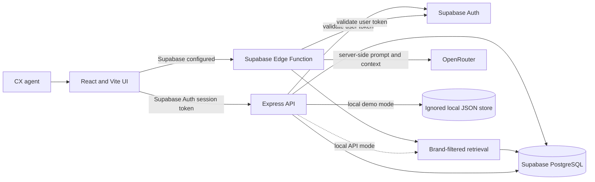

# AI-Powered CX Reply Assistant

A small customer-support workspace for reviewing conversations, retrieving brand-specific policies, drafting replies, and saving an agent-approved response.

## Problem

Support agents need fast, consistent answers, but a policy that is correct for one brand may be wrong for another. AI suggestions also need to be reviewable and must not invent policies or send messages without human approval.

## Solution

The app filters knowledge by the conversation's selected brand, retrieves only entries relevant to the latest customer message, and asks a server-side AI provider to draft a reply. Unsupported questions and known out-of-window damage requests receive safe deterministic responses. Agents can edit a draft or write manually, then save the final message to the conversation.

## Features

- Brand-filtered conversations and policy knowledge
- Keyword/category-based retrieval with tests for brand isolation
- Supabase Auth and PostgreSQL persistence when configured
- Persistent local demo store when Supabase is not configured
- Knowledge-base create, read, update, and delete
- Server-side OpenRouter integration; provider keys are never sent to the browser
- Unsupported-question and damaged-report-window guardrails
- Manual editing, regeneration, approval, and message persistence
- AI interaction, edits, and final response logging
- Visible manual fallback when the AI provider is missing or fails

## Architecture



See [docs/architecture-and-ownership.md](docs/architecture-and-ownership.md) for scaling, reliability, tenant isolation, AI cost investigation, and an interview-answer framework.

## Tech Stack

- Frontend: React, Vite, JavaScript, Tailwind CSS, React Router
- Auth and database: Supabase Auth and PostgreSQL (optional for local demo)
- API: Node.js and Express
- AI: OpenRouter chat completions API (server-side and optional)
- Tests: Node's built-in test runner

## Database Schema

The SQL in `supabase/schema.sql` creates the brands, knowledge entries, customers, conversations, messages, and AI logs tables with foreign keys, constraints, indexes, updated timestamps, and authenticated-user RLS policies. `supabase/seed.sql` inserts GlowCare, PureBottle, their distinct policies, and sample conversations.

To use Supabase:

1. Create a Supabase project and enable email/password authentication.
2. In the SQL Editor, run `supabase/schema.sql`, then `supabase/seed.sql`.
3. Create an agent user in Supabase Authentication.
4. Copy `.env.example` to `.env` and replace the placeholders with the project URL, anon key, and server-only service-role key.
5. Install/link the Supabase CLI, deploy the function, and set its OpenRouter secret:
   ```bash
   supabase link --project-ref YOUR_PROJECT_REF
   supabase functions deploy generate-reply
   supabase secrets set OPENROUTER_API_KEY=YOUR_OPENROUTER_KEY
   supabase secrets set OPENROUTER_MODEL=openai/gpt-4o-mini
   ```
   Set `FRONTEND_ORIGIN` to the deployed UI origin to restrict function CORS, and set `VITE_USE_SUPABASE_FUNCTIONS=true` in the frontend environment only after the function is deployed.

Do not expose or commit the service-role or OpenRouter key. The API verifies the caller's Supabase access token before using its server-side database client.

## Retrieval Approach

Retrieval is deterministic keyword/category matching in `src/lib/retrieval.js`. The API loads entries for the verified conversation brand only, checks the category/title against the customer message, and supplies only the resulting entries to the model. No matches produce a safe no-policy response. Tests cover distinct brand policies, unsupported questions, and entries added with new categories.

## AI Approach

The API sends a compact prompt containing the brand name, latest customer message, and retrieved brand context to OpenRouter. Local/API mode uses the Express server and requires `OPENROUTER_API_KEY` there. With Supabase configured, deploy `supabase/functions/generate-reply` and set `VITE_USE_SUPABASE_FUNCTIONS=true` to use the Edge Function; set the OpenRouter key as a Supabase Function secret, not in the frontend or Render bundle. The default model is `openai/gpt-4o-mini`. Calls have a 25-second timeout and reject provider errors or empty output.

If the key is missing or the provider fails, the UI displays the error and keeps a manual response editable. The previous successful draft is preserved on regeneration failure. Do not describe the local demo response as AI-generated when no provider key is configured.

## Guardrails

- API validates that the requested brand matches the conversation's stored brand.
- Knowledge retrieval is restricted to that brand before prompt construction.
- Unsupported questions never call the model and receive a safe handoff response.
- Damaged-product requests whose stated reporting time exceeds the retrieved policy window cannot promise a remedy.
- The model is instructed to use only retrieved knowledge and not claim actions have already occurred.
- Agents must approve; messages are never automatically sent externally.
- OpenRouter and Supabase service-role credentials remain server-side.

## Local Setup

Requirements: Node.js 20.19+ and npm.

```bash
npm install
npm test
npm run dev:full
```

Open `http://localhost:5173`. In local demo mode, enter any valid-looking email and any password. Demo records and CRUD changes persist in `.local/store.json` (ignored by Git). The local API runs at `http://localhost:3001`; its health check is `http://localhost:3001/api/health`.

Without Supabase configuration the app uses its local demo store. Without an OpenRouter key, supported requests use the manual fallback; unsupported and deterministic out-of-policy guardrails still work. To enable actual AI locally, add only `OPENROUTER_API_KEY` and optionally `OPENROUTER_MODEL` to `.env`.

## Environment Variables

See `.env.example` for all variable names.

| Variable | Where used | Required |
| --- | --- | --- |
| `VITE_SUPABASE_URL` | Browser Supabase Auth | Only for Supabase mode |
| `VITE_SUPABASE_ANON_KEY` | Browser Supabase Auth | Only for Supabase mode |
| `VITE_USE_SUPABASE_FUNCTIONS` | Routes reply generation to the deployed Supabase Edge Function | Optional |
| `VITE_API_BASE_URL` | Browser API URL in deployment; local dev uses Vite proxy | Deployment only |
| `SUPABASE_URL` | Server database and Auth validation | Supabase mode |
| `SUPABASE_ANON_KEY` | Server-side JWT validation | Supabase mode |
| `SUPABASE_SERVICE_ROLE_KEY` | Server-only database access | Supabase mode |
| `OPENROUTER_API_KEY` | Server-side AI calls | AI generation |
| `OPENROUTER_MODEL` | Server-side model selection | Optional |
| `PORT` | Express listener | Optional; defaults to 3001 |

## Deployment

This workspace is not currently deployed. Deployment needs the owner's Supabase/OpenRouter credentials and hosting account; no live URL is claimed.

`render.yaml` provides a single-service Render Blueprint: it builds the Vite bundle and serves the UI and API from the same Node 20 service. First deploy the Supabase schema/seed and Edge Function; then create a Render Blueprint for this repository and supply the Supabase URL, anon key, and server-only service-role key. The Blueprint builds with `VITE_USE_SUPABASE_FUNCTIONS=true`, so reply generation calls the deployed Edge Function. Store `OPENROUTER_API_KEY` as a Supabase Function secret, not in Render. The API health route is `/api/health`. Create an agent user in Supabase Auth before logging in. Do not enable local demo mode for a public deployment because it has no real authentication and its JSON store is not suitable for persistent hosting.

Alternatively, deploy `dist` to a static Vite host and the API to a Node 20 host. Set `VITE_API_BASE_URL=https://<your-api-host>/api` at frontend build time and configure the API CORS policy for the deployed frontend origin. Both services must use HTTPS.

After deploying, test login, brand switching, knowledge CRUD, generation, edits, approval, logs, unsupported requests, and provider failure from a clean browser.

## Evaluation

Run deterministic tests with:

```bash
npm test
```

The required scenarios are in `evaluation/test_cases.json`. Automated retrieval/guardrail tests are in `evaluation/retrieval.test.js`; UI, real Supabase, OpenRouter, and deployed-host checks must be completed with credentials and a browser before claiming those cases pass.

## Known Limitations

- No Supabase project or hosting provider is provisioned by this source tree; local demo mode is the default.
- Real OpenRouter generation requires a valid server-side key and has not been exercised without that credential.
- The conversation list is sample data; external messaging channels are not integrated.
- Keyword retrieval is intentionally simple. Category/title matching should be evaluated as policy content grows.
- RLS is authenticated-user-wide for this single-workspace assignment, not per-agent or per-tenant authorization.
- The Express API uses a server-only Supabase service role after verifying the user token; it does not expose the service key to the browser.

## Future Improvements

- Deploy and verify against a real Supabase project and OpenRouter account.
- Add request-level authorization by agent role and tenant/brand membership.
- Improve query normalization and measure retrieval precision/recall with the evaluation set.
- Add idempotency and a transaction/RPC for atomically saving final messages and updating AI logs.
- Add rate limiting, structured telemetry, token/cost tracking, and provider fallback configuration.
- Consider hybrid full-text/semantic retrieval only after measured keyword retrieval gaps.
