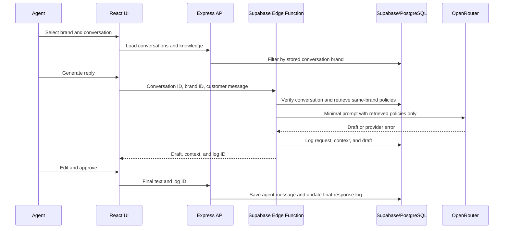

# Architecture, Scale, Reliability, and Ownership

## MVP request path

With Supabase configured, the UI calls the deployed Edge Function for generation; it calls the Express API for conversation and knowledge CRUD. The Express API retains a server-side OpenRouter route for local use when configured. In local demo mode, PostgreSQL is replaced with an ignored JSON store and demo authentication is deliberately not secure. Production mode requires Supabase Auth, PostgreSQL, and Edge Function secrets.

## Multi-brand isolation

The frontend brand picker is a convenience, not a trust boundary. For generation, the API verifies the conversation exists and compares its database brand ID with the requested brand ID. It then loads knowledge using that brand ID only. The model receives only the filtered entries. The API verifies the user's Supabase token before database access; SQL RLS restricts browser-role access to authenticated users. The service-role key exists only on the server and is used only after token verification.

For a multi-tenant product, replace authenticated-user-wide RLS with membership tables and policies that assert the current user is authorized for the record's tenant/brand. Apply the same ownership rule to conversations, knowledge, messages, and logs. Never infer access from user-supplied brand IDs alone.

## Evolution for 500 brands, 5,000 agents, millions of messages, and multiple channels

Keep the MVP's API stateless and scale its instances behind a load balancer or API gateway. Put the React bundle behind a CDN. Use Supabase/PostgreSQL initially with connection pooling, indexes on tenant/brand and conversation/time columns, and query pagination. Measure database load before adding read replicas or partitioning messages by time/tenant.

At larger scale:

- Use explicit tenant and agent-membership authorization with RLS.
- Introduce cursor pagination and partition large message/log tables when measured query or maintenance costs justify it.
- Move slower AI and webhook work to a queue with bounded retries, idempotency keys, and a dead-letter path.
- Use a channel adapter layer to normalize email, chat, and messaging provider events into the same conversation/message model.
- Consider hybrid full-text and vector retrieval with mandatory brand/tenant metadata filters only if evaluation demonstrates keyword retrieval misses relevant policies.
- Centralize model routing, rate limits, token accounting, redaction, and provider fallback in an AI gateway.
- Add observability for request latency, retrieval results, AI provider errors, token use, database query health, and final-response outcomes.

Do not add Kafka, Redis, vector infrastructure, or microservices until traffic and operational measurements establish a need.

## Reliability and correctness

- Validate payload shape and conversation/brand association at the API.
- Keep retrieval deterministic and scoped before any AI request.
- Use a time-limited server-side AI request, validate provider status and output, and preserve an editable manual draft on failure.
- Keep a previous successful suggestion when regeneration fails.
- Require a human approval step; never automatically send.
- Record retrieved context and output, then store the agent's final response.
- Use database transactions or a Postgres RPC to atomically save the final message and update its AI log before production use.
- Add idempotency keys for approval requests to prevent duplicate messages if a client retries.
- Keep evaluation cases for supported policies, cross-brand isolation, unsupported questions, out-of-policy requests, edits, and provider failure.

## AI cost investigation

No production or provider usage has been observed for this repository, so there are no measured costs to claim. Investigate cost with real usage in this order:

1. Measure request count, prompt/completion tokens, provider/model, latency, retries, regeneration count, and cost by brand and use case.
2. Attribute cost to repeated calls, oversized history/context, output length, model selection, and retry/regeneration behavior.
3. Send only the latest customer message and the smallest relevant knowledge entries. Avoid sending full histories unless an evaluation proves they are needed.
4. Put output-token limits and request timeouts in place. Debounce duplicate generation actions and use idempotency where appropriate.
5. Compare a lower-cost model and caching of stable retrieval results against a fixed evaluation set; do not cache generated replies across different customer contexts.
6. Monitor answer quality and policy violations alongside token/cost changes. Revert cost changes that measurably harm correctness.

The current integration already bounds output size, sends a compact brand-filtered prompt, and applies a 25-second timeout. Token/cost telemetry and rate limits are follow-up production work.

## Ownership and leadership discussion

Use this as an answer structure and replace the prompts with genuine examples from your experience; it is not a claim about past work:

- **Ownership:** State the user problem, the measurable outcome, the boundaries of your responsibility, and how you communicated delivery risks.
- **Trade-offs:** Explain why this MVP uses keyword retrieval and a human approval gate before adding vector infrastructure or channel integrations.
- **Reliability:** Describe a failure mode, how it was detected, how the manual path preserves agent work, and what follow-up test prevents regression.
- **Cost:** Describe the measurements you would gather before changing the model or adding caching, and how you would protect response quality.
- **Leadership:** Explain how you would align support, product, security, and engineering around policy ownership, rollout criteria, and an escalation path for incorrect suggestions.
- **Learning:** Clearly separate verified measurements from assumptions and identify what you would validate next.
